# Karthik G K

**CS student building at the intersection of computer vision, deep learning, GenAI and embedded systems.**

I like taking a model off the notebook and onto real hardware or into a product people can use: a driver-monitoring pipeline on a Raspberry Pi, an offline LLM tutor on a laptop, a navigation stack that keeps working when GNSS does not.

- Currently working on a multi-node driver monitoring system (Pi 5 + STM32 + ESP32)
- Practising DSA in C++ every day in [brute-to-better](https://github.com/kart747/brute-to-better)
- Open to internships and collaboration on ML, CV and GenAI projects

## Featured projects

| Project | What it is | Stack |
| --- | --- | --- |
| [autoliv-dms](https://github.com/kart747/autoliv-dms) | Driver monitoring system: vision drowsiness baseline (EAR, MAR, PERCLOS) feeding an STM32 safety ECU | Python, MediaPipe, Raspberry Pi 5, STM32, ESP32 |
| [AmazonML](https://github.com/kart747/AmazonML) | Business entity resolution across three noisy sources at 10M+ record scale; F0.5 0.978 on the Amazon ML Challenge 2026 leaderboard | Python, LightGBM, Polars, scikit-learn |
| [gnss-free-dead-reckoning](https://github.com/kart747/gnss-free-dead-reckoning) | AI/ML dead-reckoning navigation for GNSS-denied and spoofed environments (Smart India Hackathon 2026) | PyTorch, sensor fusion |
| [Greenroom](https://github.com/kart747/Greenroom) | Offline, open-source English speaking coach with a local LLM tutor | Python, local LLMs, speech |
| [mynah](https://github.com/kart747/mynah) | Offline Android reading companion: EPUB/PDF import, read-aloud with synced highlighting, on-device word meanings | Flutter, Dart, on-device LLM |
| [yojanapath](https://github.com/kart747/yojanapath) | Bilingual government-scheme eligibility navigator for rural India (USAII Global AI Hackathon 2026) | React, FastAPI, LLMs |
| [TruthLens](https://github.com/kart747/TruthLens) | Real-time deepfake image detector on a fine-tuned ResNet18, 98% validation accuracy | PyTorch |
| [AlgoGenius](https://github.com/kart747/AlgoGenius) | LeetCode-style platform with AI problem generation and a Docker execution sandbox | Next.js, FastAPI, Docker |
| [unet-pytorch](https://github.com/kart747/unet-pytorch) | U-Net for semantic segmentation, implemented from scratch from the paper | PyTorch |
| [artscape](https://github.com/kart747/artscape) | Interactive art collection that follows visual motifs across artworks (ACM x MLH Hack Days 2026) | TypeScript, Gemini |

## Tech stack

**Languages:** Python, C++, TypeScript, JavaScript, Dart

**ML / CV:** PyTorch, OpenCV, MediaPipe, scikit-learn, CUDA

**GenAI:** LLM applications, local/offline models, RAG, prompt and agent design

**Embedded:** Raspberry Pi, STM32, ESP32, Arduino

**Web / tools:** FastAPI, React, Next.js, Docker, Git, Linux
